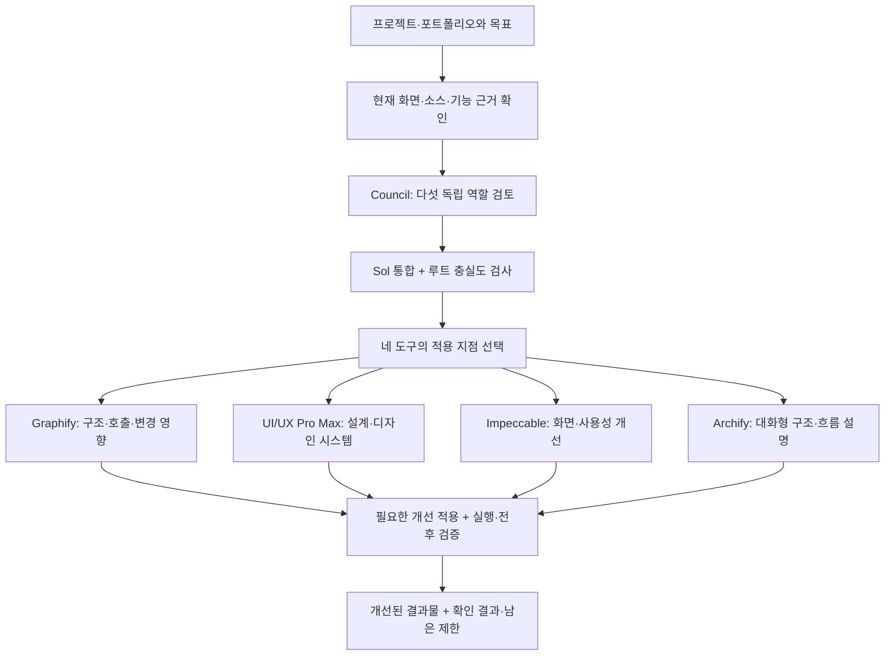

# Total — Council로 검토하고 실제로 개선하는 Codex 스킬 번들

프로젝트나 포트폴리오를 지정하고 **`$total` 한 번으로 개선점 발견 → 적용 → 검증**까지 진행합니다. Council이 먼저 목적·근거·위험·사용자 이해를 검토하고, UI/UX Pro Max·Graphify·Impeccable·Archify를 사용할 지점을 선택합니다.

[English](README.en.md) · [파일 구성과 누락 검증](docs/CONTENTS.md) · [설치·검증 스크립트](scripts/install.py) · [출처·라이선스](NOTICE.md)



네 도구의 적용 가능성은 모두 확인합니다. 실제 실행은 대상과 개선 목적에 맞게 선택하며, 관련 없는 기능은 이유를 남겨 제외합니다. 코드 없는 문서에 호출 그래프를 억지로 만들거나 이미 충분한 화면을 의미 없이 바꾸지 않습니다. 도구 순서는 개선의 의존 관계에 맞춥니다.

## 포함 스킬

| 스킬 | 역할 | 함께 들어 있는 주요 파일 |
|---|---|---|
| [total](skills/total/SKILL.md) | 통합 진입점·적용·검증 | Council 적용 지도, 검증/포트폴리오 지침, 의존성 검사 |
| [council](skills/council/SKILL.md) | 독립 검토·방향 통합 | 역할 프로필 TOML 3개, 레시피, 평가 지침 |
| [ui-ux-pro-max](skills/ui-ux-pro-max/SKILL.md) | UI 설계·정보 구조·디자인 시스템 | Python 검색 스크립트, UX·스타일·폰트·아이콘·스택 데이터 |
| [graphify](skills/graphify/SKILL.md) | 구조·호출 관계·변경 영향 | 공식 상세 워크플로, 추출/쿼리/업데이트 참고문서 |
| [impeccable](skills/impeccable/SKILL.md) | 화면·가독성·사용성 개선 | 모든 playbook·문맥·브라우저 보조 스크립트, Windows x64 엔진 |
| [archify](skills/archify/SKILL.md) | 대화형 구조도·흐름도 | CLI·렌더러·뷰어·schema·template·예제·검증 자원 |
| [karpathy-guidelines](skills/karpathy-guidelines/SKILL.md) | 범위·가정·집중된 변경·검증 | 출처와 수정 전 upstream 원문 |
| [6-1-sol-orch](skills/6-1-sol-orch/SKILL.md) | 필요한 독립 구현 작업의 위임 | 모델·역할·파일 소유권 지침, 라이선스·출처 |

마지막 두 개는 `total`이 참조하는 지원 스킬입니다. 별도의 Council 검토를 중복 수행하지 않습니다. 스킬을 폴더 안에 감춰 두는 대신 `skills/` 아래 형제 폴더로 배포해, 원본 참고문서와 실행 파일의 상대경로를 유지합니다.

## 설치

필요한 환경: **Codex의 스킬 지원**, Python 3.11 권장, Node.js **18 이상**, Graphify 설치용 [uv](https://docs.astral.sh/uv/getting-started/installation/). Council에는 아래 모델과 `max` 추론, 서브에이전트 실행 기능이 필요합니다. 파일 복사만으로 계정의 모델 권한이나 슬롯이 늘어나지는 않습니다.

```powershell
git clone https://github.com/Kimhyuntae9665/codex-skill-total.git
cd codex-skill-total

# 먼저 번들 무결성과 설치 대상을 확인
python scripts/install.py --dry-run

# 여덟 스킬을 CODEX_HOME/skills 또는 기본 ~/.codex/skills에 설치
python scripts/install.py

# Graphify CLI와 PDF/Office/MCP 지원 라이브러리 설치
uv tool install --python 3.11 "graphifyy[pdf,office,mcp]==0.9.84"
```

macOS/Linux에서는 `python` 대신 `python3`를 사용하면 됩니다. `uv`가 있는데 Python 명령이 없다면 `uv run --python 3.11 python scripts/install.py`로 실행할 수 있습니다. Node.js와 uv 자체는 자동 설치하지 않습니다. 설치한 스킬은 Codex의 다음 턴에서 확인하세요.

기존 같은 이름의 대상 폴더가 있으면 설치를 **수정 전에 중단**합니다. 다른 위치를 시험하거나, 기존 폴더를 백업하고 교체하려면 다음과 같이 실행합니다.

```powershell
python scripts/install.py --dest ./test-skills --dry-run
python scripts/install.py --dest ./test-skills

# 기존 대상은 .total-backups/<UTC timestamp>/ 아래에 보존
python scripts/install.py --overwrite
```

`--dest`는 실제 설치 루트입니다. 프로젝트 전용 설치는 `--dest ./.codex/skills`처럼 지정하세요. 기본 경로가 아닌 경우 각 스킬의 실제 위치를 기준으로 명령을 실행합니다. 스킬 진입점의 링크와 Total 의존성 검사는 번들 안의 형제 스킬을 우선 확인합니다. 이미 다른 검색 경로에 같은 이름의 스킬이 있다면 사용 중인 Codex의 스킬 검색 경로도 확인하세요.

## 사용

```text
$total로 이 프로젝트의 구조·UI·사용성을 검토하고 개선해줘.

$total C:/path/to/project
핵심 기능과 기존 변경을 유지하면서 개선하고 실행 확인해줘.

$total로 첨부한 포트폴리오를 개선해줘.
기존 경험의 사실과 지정 페이지 수는 유지해줘.

$total로 이 프로젝트 검토만 해줘. 수정하지 마.
```

기본은 요청 범위의 **실제 개선 적용과 검증**입니다. `검토만`이면 원본을 수정하지 않고 개선 지도와 제안만 전달합니다. 대상이 명확하면 반복 승인 없이 진행하고, 대상이 없거나 충돌하면 필요한 대상만 확인합니다. 사용자 목표·디자인 방향·기존 변경을 보존하며, 게시·배포·발송·지원서 최종 제출은 각 요청의 권한 범위를 따릅니다.

## Council 실행 계약

| 역할 | 모델 | 추론 |
|---|---|---|
| Strategist | `gpt-6.1-sol` | `max` |
| Skeptic | `gpt-6-astra` | `max` |
| Creative | `gpt-6-astra` | `max` |
| Operator | `gpt-6.1-sol` | `max` |
| Audience Advocate | `gpt-6-luna` | `max` |
| Synthesizer | `gpt-6.1-sol` | `max` |

동일한 고정 패킷을 다섯 독립 역할에게 전달하고, 유효한 종료 결과 다섯 개를 받은 뒤 Sol이 통합합니다. 루트가 원문과 실제 의견에 대한 충실도를 확인한 후 개선을 적용합니다. 일부 결과만 받았거나 모델·추론 기능이 없으면 Full Council로 보고하지 않습니다. 역할별 실패 재시도는 최대 한 번입니다.

[`council/assets/`](skills/council/assets)의 프로필은 런타임이 지원할 때 사용할 설정 예시입니다. 설치 스크립트는 글로벌 `config.toml`을 수정하지 않습니다. 프로필 타입이 등록되어 있지 않아도 호스트가 정확한 모델·추론 선택을 지원하면 Council 원본 지침의 명시적 모델 지정 경로를 사용할 수 있습니다. 스킬 호출은 현재 루트 모델을 바꾸지 않습니다. Fast tier는 API가 실제 지원할 때만 요청하며, 그 밖에는 노출된 기본 tier와 확인 한계를 기록합니다.

## 무엇을 검증하고 무엇이 별도인가

- Graphify 관계는 현재 소스와 대조하고 추출·추론·모호함을 구분합니다. 그래프는 기능 테스트의 대체물이 아닙니다.
- UIUX의 디자인 시스템 생성과 실제 화면 개선은 구분합니다. 일반 검색 fallback은 제품 적합성의 증거가 아닙니다.
- Impeccable의 한 번 검사·한 번 수정·한 번 확인 범위를 지키며, detector 통과를 전체 시각·접근성 검증으로 말하지 않습니다.
- Archify의 자동 artifact/browser 검사와 실제 육안 검사를 구분합니다. 흐름도를 화면 수정 전에 쓰는 선택지는, 실제 수정 위치와 검증 기준을 명확히 하는지 한 흐름으로 시험합니다.
- 포트폴리오는 최종 형식으로 다시 렌더링해 사실 구분·업무 연결·화면 경계·관찰 안내를 확인합니다. 개인 경력 정보나 특정 PC의 private guidance는 포함하지 않습니다.

Graphify의 Python 가상환경·CLI는 별도 설치합니다. 코드 전용 AST 추출은 API 키 없이 가능하지만 문서/미디어의 의미 추출은 사용 가능한 승인된 모델 backend가 필요합니다. MCP 관련 라이브러리를 설치해도 Codex connector 등록이 되는 것은 아닙니다. Hook/watch도 자동 등록하지 않습니다.

Impeccable의 **Windows x64 0.1.14 엔진은 포함**됩니다. 다른 OS/아키텍처의 엔진은 포함하지 않으며 upstream launcher가 첫 실행에 다운로드하고 해시를 검증할 수 있습니다. Archify의 일반 CLI는 포함된 자원으로 실행하지만, upstream 전체 소스 트리용 `npm test`·개발 생성 명령은 이 스킬 스냅샷의 설치 검증 명령이 아닙니다.

## 누락 방지와 검증

```powershell
python scripts/validate_bundle.py
python -m unittest discover -s tests -v
```

[source-coverage.json](manifests/source-coverage.json)에 선택한 여덟 설치본의 **모든 원본 파일**을 포함 또는 의도적 제외로 기록합니다. 제외는 생성된 Python 캐시이며, 원본·공개본 각각의 SHA-256과 경로 수정 여부를 남깁니다. [bundle.sha256.json](manifests/bundle.sha256.json)은 최종 저장소 파일 목록과 해시를 검증하며, 상대경로 참고문서·진입점·개인 경로/credential 형태도 검사합니다. CI는 Windows와 Linux에서 번들·신규 설치·충돌 중단·백업 교체를 검사합니다.

이 검증은 누락·설치 동작의 증거입니다. 사용자의 실제 프로젝트 품질 향상, 모든 OS의 native engine 동작, 자연어 자동 선택, 모델 접근·비용을 보장하지 않습니다. 원본 다섯 스킬의 지침·모델 실행 계약은 각 진입점에서 확인하세요.

## 출처와 라이선스

자체 통합·Council·패키징 문서는 MIT, 번들된 upstream 파일은 각 원래 라이선스를 따릅니다. Apache 라이선스·NOTICE·기존 MIT 파일과 Archify의 브랜드 마크별 고지까지 유지했습니다. [NOTICE.md](NOTICE.md)에 버전·출처·수정 범위의 설명과 라이선스 링크가 있습니다. 저장소에 기록한 upstream 검토 SHA와 registry 설치 버전은 서로 다른 식별자입니다.
